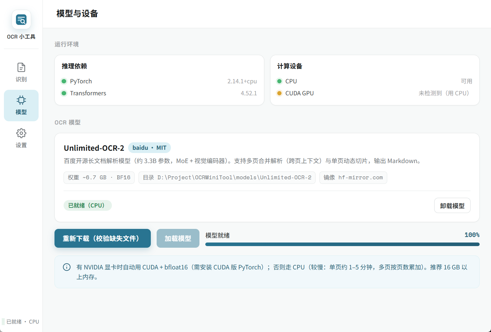
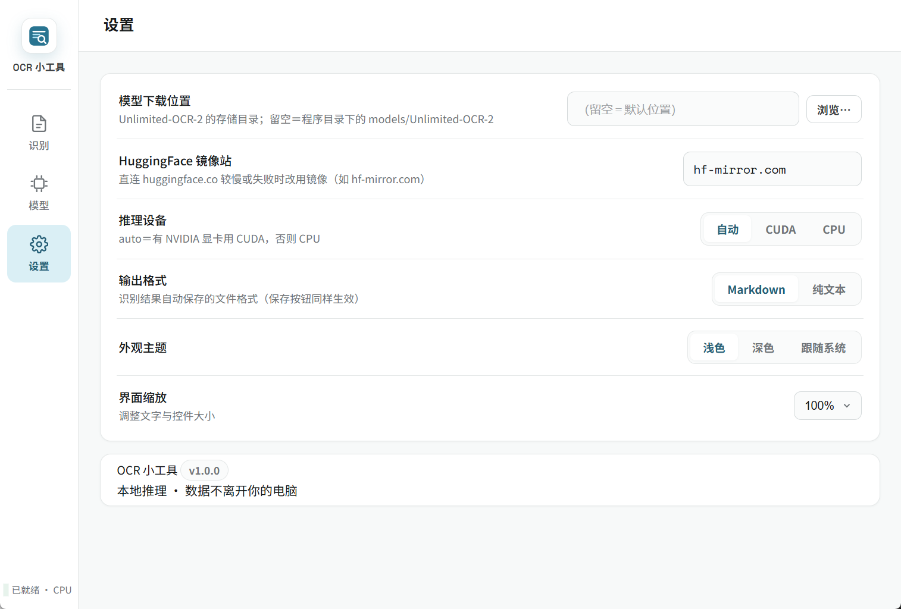

# OCRMiniTool（OCR 小工具）

本地图形化 OCR 工具 —— **数据不离开你的电脑**。以百度开源的
[**Unlimited-OCR-2**](https://huggingface.co/baidu/Unlimited-OCR-2)（MIT，约 3.3B 参数）为核心，
拖入图片 / PDF 即可解析出 Markdown 文本。**WebView 界面**（原生 WebView2 窗口），
支持 CUDA GPU 加速与纯 CPU 推理（自动检测）。

> 界面框架参考 [Superce1l/STTMiniTool](https://github.com/Superce1l/STTMiniTool)（同一套
> 本机 HTTP server + SSE + WebView2 架构与视觉语言）。模型上游：
> [baidu/Unlimited-OCR](https://github.com/baidu/Unlimited-OCR)

---

## 主要特色

- 🖼️ **图片 / PDF → Markdown**：jpg・png・bmp・webp・tiff 拖入即识；
  PDF 自动逐页转图（pymupdf）
- 📚 **两种识别模式**：**合并解析**（多文件当作同一文档的多页，一次请求带跨页上下文）
  与 **批量识别**（每个文件独立识别、独立出结果，失败不中断队列，可随时取消）
- 🔍 **单页 gundam 模式**：单图动态切片（模型原生能力），大版面文档细节更全
- ⬇️ **模型一键下载**：约 6.8 GB 权重从 HuggingFace 下载，支持断点续传、完整性校验、
  镜像站（如 hf-mirror.com）加速
- 🖥️ **CUDA / CPU 自适应**：有 NVIDIA 显卡自动用 CUDA + bfloat16；否则纯 CPU
  （自带 CPU 兼容补丁，绕过模型源码中的 `.cuda()` 硬编码）
- 📝 **结果预览 + 导出**：Markdown 实时渲染 / 原文切换、逐页查看、复制全文、
  另存 `.md` / `.txt`（输出格式在设置页选择）
- ⏹️ **识别可中断**：流式解码 + 实时「已生成 N 字」，取消在 1～2 秒内生效
- 🕘 **最近识别**：`outputs/` 产出列表，点击回填查看；删除进回收站
- 🎨 **深浅色主题 + 界面缩放**
- 🌍 **多语言界面**：中文（默认）/ English / Español，设置页下拉切换、即时生效；
  文案集中于 `webview/locales/*.json`（前端与后端共用）——**新增语言只需丢一份
  `<code>.json`**（含 `meta.nativeName` 母语名），下拉框自动出现新选项，无需改代码
- 📜 **运行日志**：下载／加载／识别事件自动记录到 `logs/`

---

## 界面导览

### 识别


*识别页 —— 拖入或选择图片（可多选；PDF 亦可）后：*

1. 选择**识别模式**：
   - **合并解析**（默认）：多个文件当作同一文档的多页，一次请求合并识别（跨页上下文），
     适合同一份文档拆成的多张图 / 多页 PDF
   - **批量识别**：每个文件独立识别、独立出结果，逐文件显示进度与成败，
     单个失败不影响后续；适合一堆互不相关的截图 / 扫描件
2. 可在「**识别指令**」输入自定义指令（留空＝模型默认的文档解析）
3. 点「**▶ 开始识别**」，进度条实时显示（已生成字数 + 已用时）；点「取消」1～2 秒内中断
4. 完成后正文区呈现 **Markdown 渲染结果**，可切「原文」查看原始 Markdown、
   多页时按页标签切换、「复制全文」或「保存」；批量模式下结果按文件列表展示，点击查看
5. 「**打开输出文件夹**」直达 `outputs/`（识别结果按设置的格式自动存为 `.md` / `.txt`，
   批量模式每个文件一份）

### 模型



*模型页 —— 运行环境自检（PyTorch / Transformers / CUDA 检测）与 Unlimited-OCR-2 模型卡，
下载、加载、就绪状态与进度一目了然。*

- **运行环境自检**：PyTorch / Transformers 版本、CUDA GPU 检测
- **模型卡**：Unlimited-OCR-2 状态（未下载 → 下载中 → 已下载 → 加载中 → 已就绪）
- 「**下载模型**」约 6.8 GB（首次）；「**加载模型**」完成后即可识别
  （启动时若模型已下载会自动加载）

### 设置



*设置页 —— 模型下载位置、HuggingFace 镜像站、推理设备、输出格式、外观主题与界面缩放。*

| 设置项 | 说明 |
|--------|------|
| **模型下载位置** | Unlimited-OCR-2 的存储目录；留空＝程序目录下的 `models/Unlimited-OCR-2` |
| **HuggingFace 镜像站** | 直连 huggingface.co 较慢或失败时改用镜像（如 `hf-mirror.com`） |
| **推理设备** | 自动（有 NVIDIA 用 CUDA）/ CUDA / CPU |
| **输出格式** | 识别结果自动保存与「保存」按钮导出的文件格式：Markdown（`.md`）/ 纯文本（`.txt`） |
| **外观主题** | 浅色／深色／跟随系统 |
| **界面缩放** | 调整文字与控件大小 |
| **界面语言** | 下拉选择（中文默认 / English / Español…）；选项自动发现自 `webview/locales/`，持久化到 `settings.json` 的 `lang` |

---

## 性能预期

| 设备 | 加载 | 单页识别（约 1000 字文档） |
|------|------|---------------------------|
| CUDA GPU（≥8 GB 显存） | 1–2 分钟 | 数秒～十几秒 |
| CPU（推荐 ≥16 GB 内存） | 1–3 分钟 | **约 3–15 分钟**（MoE 架构、bf16，慢属正常） |

> 模型为 64 选 6 的 MoE 架构（每 token 仅激活部分专家），CPU 上也可运行，
> 但无 GPU 时请耐心等待；进度条会显示已用时。

---

## 项目结构

```
app_webview.py          # 唯一入口：原生 WebView2 窗口 + 本机 HTTP server
webview_server.py       # 本机 stdlib HTTP server（serve webview/ + /api，SSE 推送）
webview_backend.py      # 后端逻辑（状态机、模型下载/加载、识别、设置、历史）
ocr_engine.py           # Unlimited-OCR-2 推理引擎（transformers trust_remote_code）
ocr_postprocess.py      # 模型布局块输出 → Markdown（移植自上游 utils/process_unlimitedOCR2.py）
downloader.py           # 模型下载（HF + 镜像、断点续传、完整性校验）
settings_store.py       # settings.json 单点原子读写
i18n.py                 # 后端多语言（读 webview/locales/*.json，SSE 文案/对话框）
applog.py               # 运行日志
proc_guard.py           # Windows Job Object（进程退出连带清理）
version.py              # 版本单一事实来源
webview/                # 前端（HTML / CSS / JS）
webview/locales/        # 语言包 en / zh / es（前后端共用，加语言=加一份 JSON）
assets/make_icon.py     # 图标生成（Pillow 绘制 → PNG/ICO）
OCRMiniTool.spec        # PyInstaller onefile 打包配置
runtime_hook_utf8.py    # 冻结运行时 UTF-8 / 证书修复钩子
```

---

## 安装与运行

### 打包 EXE（推荐）

双击 `dist\OCRMiniTool.exe` 即可（单文件，无需安装 Python）。

- **模型位置**：exe 会自动在其所在目录寻找 / 下载 `models\Unlimited-OCR-2`。
  建议把 exe 放进一个独立文件夹（如 `D:\OCRMiniTool\`）再运行；
  也可以在界面「设置 → 模型下载位置」指定任意已有模型目录。
- **首次启动**：onefile 版需要解压运行时（约 10～30 秒），属正常。
- **数据文件**：`outputs\`（识别结果）、`logs\`（运行日志）、`settings.json`
  都生成在 exe 所在目录。

重新打包：

```bat
pip install pyinstaller
pyinstaller --noconfirm --distpath dist --workpath build OCRMiniTool.spec
```

### 源码执行

```bash
cd OCRMiniTool
pip install -r requirements.txt
python app_webview.py          # 启动 WebView 界面
```

> 注意 `pythonnet` 已钉在 3.1.0：3.2.x 在部分机器的 .NET Framework 上报
> `Failed to resolve Python.Runtime.Loader.Initialize`，原生窗口无法打开。

### GPU 加速（可选）

默认 pip 安装的是 CPU 版 torch。有 NVIDIA 显卡（驱动支持 CUDA 12.8+）时：

```bash
pip install torch torchvision --index-url https://download.pytorch.org/whl/cu128 --force-reinstall
```

### 命令行下载模型（可选）

```bash
python downloader.py [目标目录]     # 不启动界面，直接下载/续传
```

---

## 系统需求

| 项目 | 要求 |
|------|------|
| 操作系统 | Windows 10 / 11（64-bit） |
| 内存 | 16 GB 以上（权重 6.7 GB + 运行开销） |
| 硬盘 | 8 GB（模型 6.8 GB + 系统） |
| GPU | 可选：NVIDIA（CUDA 12.8+）≥8 GB 显存；无 GPU 走 CPU |
| WebView2 | Windows 11 内建；Windows 10 需安装 Edge WebView2 Runtime（缺失时自动改用 Edge --app 窗口） |

---

## 模型来源

| 项目 | 链接 |
|------|------|
| Unlimited-OCR-2 权重与代码 | [baidu/Unlimited-OCR-2](https://huggingface.co/baidu/Unlimited-OCR-2)（MIT） |
| 上游仓库（论文 / SGLang 部署） | [baidu/Unlimited-OCR](https://github.com/baidu/Unlimited-OCR) |

---

## 授权

本项目代码以 **MIT** 授权释出。模型权重与自定义代码依
[baidu/Unlimited-OCR-2](https://huggingface.co/baidu/Unlimited-OCR-2) 的授权条款（MIT）。

---

## 致谢

- [STTMiniTool](https://github.com/Superce1l/STTMiniTool) —— 界面框架与工程实现的参考来源
- [baidu/Unlimited-OCR](https://github.com/baidu/Unlimited-OCR) —— OCR 模型
- [DeepSeek-OCR](https://github.com/deepseek-ai/DeepSeek-OCR) —— 上游模型思想来源

---

## 相关链接
[Linux.do](https://linux.do/): 连接开发者与 AI 爱好者的社区。