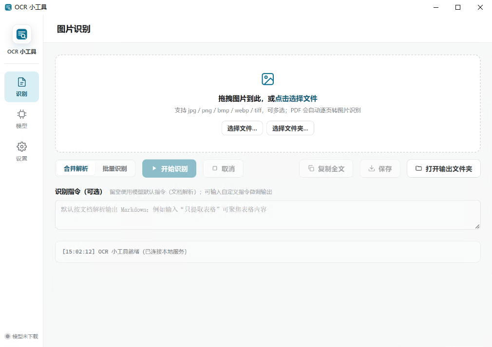
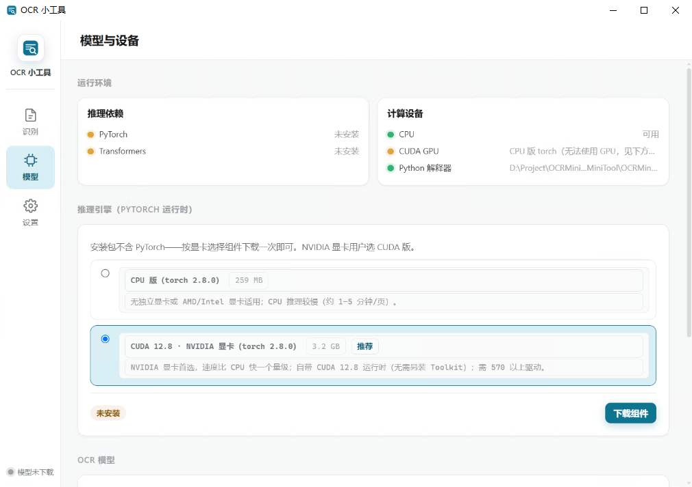
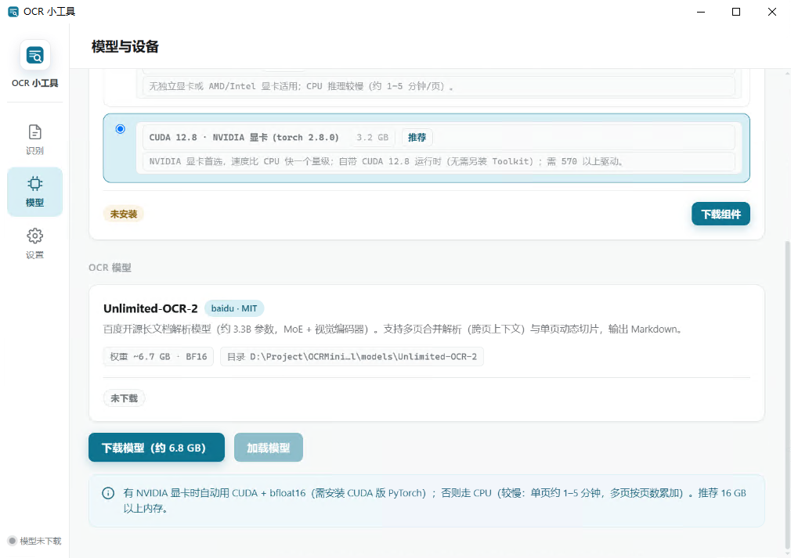
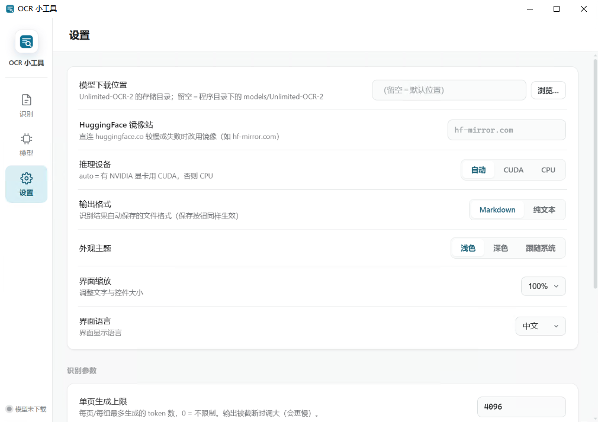
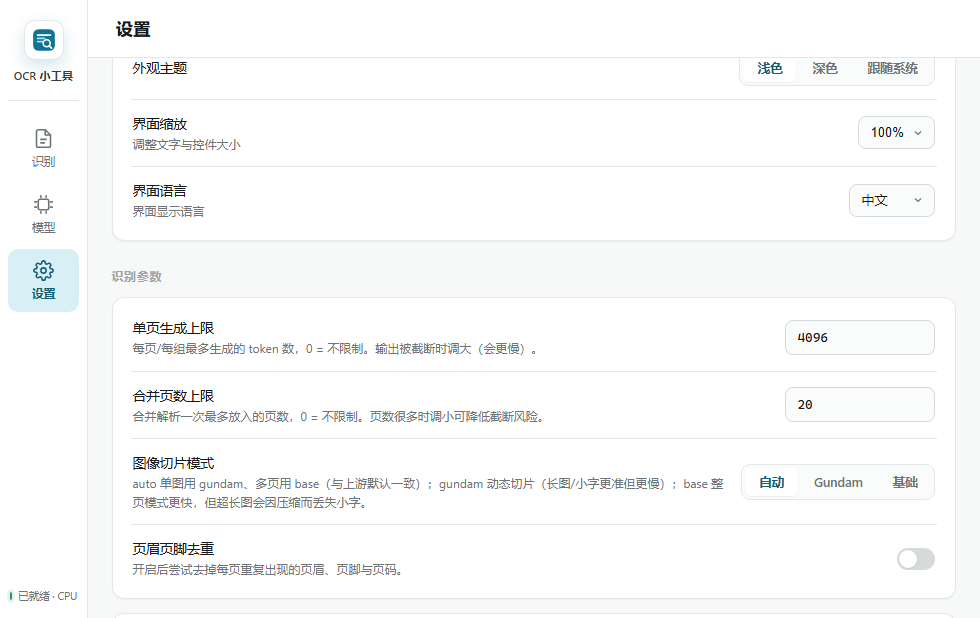

# OCRMiniTool（OCR 小工具）

本地图形化 OCR 工具 —— **数据不离开你的电脑**。以百度开源的
[**Unlimited-OCR-2**](https://huggingface.co/baidu/Unlimited-OCR-2)（MIT，约 3.3B 参数）为核心，
拖入图片 / PDF 即可解析出 Markdown 文本。**WebView 界面**（原生 WebView2 窗口），
支持 CUDA GPU 加速与纯 CPU 推理（自动检测）。

> 界面框架参考 [Superce1l/STTMiniTool](https://github.com/Superce1l/STTMiniTool)（同一套
> 本机 HTTP server + SSE + WebView2 架构与视觉语言）。模型上游：
> [baidu/Unlimited-OCR](https://github.com/baidu/Unlimited-OCR)

---

## 主要特色

- 🖼️ **图片 / PDF → Markdown**：jpg・png・bmp・webp・tiff 拖入即识；
  PDF 自动逐页转图（pymupdf）
- 📚 **两种识别模式**：**合并解析**（多文件当作同一文档的多页，一次请求带跨页上下文）
  与 **批量识别**（每个文件独立识别、独立出结果，失败不中断队列，可随时取消）
- 🔍 **图像切片三档**：**自动**（单图 gundam、多页 base，与上游一致）/ 强制
  gundam（动态切片，长图与小字更准但更慢）/ 强制 base（快，但超长图会因压缩丢小字）——设置页可选
- 🧮 **生成限幅 + 自动分组**：单页生成上限（默认 4096 token）与合并页数上限
  （默认 20 页，超出自动分组、组间可取消）；输出被截断或页数不符时，结果区
  明确提示「期望 N 页、实际 M 页」并给出该调哪个参数
- 🧹 **页眉页脚去重**（可选）：书籍/论文扫描件可去掉页眉、页脚、页码噪声
- 📄 **PDF 指定页范围**：只识别需要的页（如 `1-3,5,10-`），几百页的 PDF 不必整本跑
- ✨ **后处理开关**（可选）：合并段落断行、中英文之间补空格；LaTeX 定界符自动归一；
  表格列数异常时结果区给出提示
- 📋 **粘贴截图 + 键盘操作**：Ctrl+V 直接把剪贴板图片加入队列；Ctrl+Enter 开始识别、
  Esc 取消；拖放区可用 Tab 聚焦；进度、日志与结果对读屏软件有语义
- 📁 **整目录识别**：选一个文件夹即批量入列（后端直读路径，不上传、不占临时盘）
- 🔁 **失败可重试**：批量模式下单个文件失败不影响队列，失败项可看完整错误并只重跑失败项；
  所有成功项还能一键「**导出全部（合并）**」成一份带文件小标题的 Markdown
- 📂 **可配置输出目录**：设置页可指定输出与「最近识别」的目录（留空 = 程序目录下 `outputs`），
  「打开输出文件夹」与历史列表都会跟随
- 💻 **无头 CLI**：`python cli.py --input <文件/目录> [--json]`，给脚本与自动化用
  （见 [docs/cli.md](docs/cli.md)）
- ⬇️ **模型一键下载**：约 6.8 GB 权重从 HuggingFace 下载，支持断点续传、完整性校验、
  镜像站（如 hf-mirror.com）加速
- 🖥️ **CUDA / CPU 自适应**：有 NVIDIA 显卡自动用 CUDA + bfloat16；否则纯 CPU
  （自带 CPU 兼容补丁，绕过模型源码中的 `.cuda()` 硬编码）
- 📝 **结果预览 + 导出**：Markdown 实时渲染 / 原文切换、**原文可直接改字**（逐页编辑，
  保存与复制取改后的内容）、逐页查看、复制全文、另存 `.md` / `.txt` / `.json`（输出格式在设置页选择）
- 📦 **结构化 JSON 输出**：每页的版面块（类型 / 标题层级 / bbox 坐标 / 阅读序 / 渲染片段），
  GUI 导出、CLI `--format json` 与 HTTP 响应三处同构——可直接给下游做表格重建、版面分析、坐标定位
- 🔎 **结果内查找 / 替换**：在原文视图里查找、上一个/下一个定位、替换与全部替换，
  改完仍可保存（多页结果按当前页处理，「全部」视图只读）
- ⏹️ **识别可中断**：流式解码 + 实时「已生成 N 字」，取消在**解码阶段** 1～2
  秒内生效；视觉编码的单次前向不可中断（长页可达数十秒～数分钟，界面会如实提示）
- 🧩 **推理引擎按需下载**：安装包不含 PyTorch（~145MB 级；v1.2.0 实测 zip 约 144MB）；模型页按显卡二选一
  下载运行时组件——CPU（约 260MB）/ CUDA 12.8 · NVIDIA 专用（约 3.3GB，自带
  CUDA 运行时，无需装 Toolkit，需 570+ 驱动）。断点续传、装完即用、**整包 sha256 校验**
  （默认告警，`OCRMT_VERIFY_RUNTIME=strict` 时不一致删除）；进入模型页
  时自动检测硬件并推荐（组件由 `build_components.py` 从官方 wheel 打包，
  发布于仓库 GitHub Release）。**换组件需要退出程序再重开**：运行中已加载的
  DLL 无法覆盖，程序会提前拦下并提示，不会让你白等一次 3.5 GB 下载
- 🕘 **最近识别**：`outputs/` 产出列表，点击回填查看；删除进回收站
- 🎨 **深浅色主题 + 界面缩放**
- 🌍 **多语言界面**：中文（默认）/ English，设置页下拉切换、即时生效；
  文案集中于 `webview/locales/*.json`（前端与后端共用）——**新增语言只需丢一份
  `<code>.json`**（含 `meta.nativeName` 母语名），下拉框自动出现新选项，无需改代码
- 📜 **运行日志**：下载／加载／识别事件自动记录到 `logs/`

---

## 界面导览

### 识别



*识别页 —— 拖入或选择图片（可多选；PDF 亦可），也可以直接「选择文件夹」整目录入列：*

1. 选择**识别模式**：
   - **合并解析**（默认）：多个文件当作同一文档的多页，一次请求合并识别（跨页上下文），
     适合同一份文档拆成的多张图 / 多页 PDF
   - **批量识别**：每个文件独立识别、独立出结果，逐文件显示进度与成败，
     单个失败不影响后续；适合一堆互不相关的截图 / 扫描件
2. 可在「**识别指令**」输入自定义指令（留空＝模型默认的文档解析）
3. 点「**▶ 开始识别**」，进度条实时显示（已生成字数 + 已用时）；点「取消」在解码
   阶段 1～2 秒内中断（视觉编码阶段需等当前前向结束）
4. 完成后正文区呈现 **Markdown 渲染结果**，可切「原文」查看原始 Markdown、
   多页时按页标签切换、「复制全文」或「保存」；批量模式下结果按文件列表展示，点击查看
   - **可编辑**：切到「原文」即可直接改错字，改动写回当前页（多页结果按页编辑；
     「全部」页签是整篇只读视图），结果区会显示「已编辑」，保存/复制都取改后内容
   - **查找 / 替换**：原文视图上方有查找栏，支持上一个/下一个定位、替换与全部替换
     （多页时作用于当前页；无匹配会提示）
   - **导出 JSON**：设置里把「输出格式」选成 JSON 后，保存与自动落盘都是
     `.json`（页/块/层级/bbox/阅读序，schema 见 [docs/cli.md](docs/cli.md)）；
     历史文件没有结构化数据时会提示重新识别，不会导出空文件
5. 「**打开输出文件夹**」直达 `outputs/`（识别结果按设置的格式自动存为 `.md` / `.txt`，
   批量模式每个文件一份）
6. **整目录识别**：「选择文件夹」后由后端直接读路径批量入列（不上传、不占临时盘），
   扫描到上限时会如实告知「只取了前 N 个」
7. **失败可自救**：批量模式下单个文件失败不中断队列，失败项可展开完整错误，并「只重跑失败项」；
   成功项可一键「**导出全部（合并）**」——按原顺序拼成一份 Markdown（每份带 `# 文件名` 小标题，
   `---` 分隔），文件名 `<首个成功项>-全部.md`；识别失败会同时在页面顶部弹出**可关闭的错误横幅**
   （日志仍写到底部日志区与 `logs/`），不会再出现「点了没反应」
8. 输出被截断、页数与预期不符、或表格列数异常时，结果区顶部会出提示条：前两者
   直接告诉你该调「单页生成上限」还是「合并页数上限」，表格问题则提示核对
9. **大文件护栏**：单次请求合计超过 150 页（批量模式按单个文件计）或单文件超过 512 MB 会直接
   被拦下并说明原因——避免一次跑几小时、临时盘被占满；需要时把 PDF 拆小后再识别。
   在设置页填了「PDF 页范围」时，护栏按**选中页数**计算（几百页的 PDF 只选几页不会被误拦）
10. 识别进行中，文件选择/删除/清空/提示词输入会被锁住（改了也不生效的控件不假装可用），
   重复拖入同一个文件会自动跳过
11. **粘贴截图**：在识别页直接 Ctrl+V，剪贴板里的图片会以 `pasted-N.png` 加入队列
   （在提示词/结果编辑框里粘贴仍按普通文本处理）
12. **键盘可用**：Ctrl+Enter 开始识别、Esc 取消（仅识别中生效）；拖放区可 Tab 聚焦、
   Enter/Space 打开选择框；历史条目的删除按钮可用 Enter/Space 触发

### 模型



*模型页上半 —— 运行环境自检（PyTorch / Transformers / 计算设备）与「推理引擎」组件卡：
安装包不含 PyTorch，按显卡二选一下载即可。*



*模型页下半 —— Unlimited-OCR-2 模型卡（权重量、存储目录、下载 / 加载状态）。*

- **运行环境自检**：PyTorch / Transformers 版本、计算设备（CPU / CUDA GPU / 当前解释器）
- **推理引擎组件**：CPU 版（约 260 MB）或 CUDA 12.8 版（约 3.3 GB，自带运行时，需 570+ 驱动），
  进入模型页自动检测硬件并标出「推荐」；**换组件需要退出程序再重开**（运行中 DLL 无法覆盖）
- **模型卡**：Unlimited-OCR-2 状态（未下载 → 下载中 → 已下载 → 加载中 → 已就绪）
- 「**下载模型**」约 6.8 GB（首次）；「**加载模型**」完成后即可识别
  （启动时若模型已下载会自动加载；窗口先出、模型在后台加载）

### 设置



*设置页上半 —— 模型下载位置、HuggingFace 镜像站、推理设备、输出格式、外观主题与界面缩放。*



*设置页下半「识别参数」—— 单页生成上限、合并页数上限、图像切片模式、页眉页脚去重。*

| 设置项 | 说明 |
|--------|------|
| **模型下载位置** | Unlimited-OCR-2 的存储目录；留空＝程序目录下的 `models/Unlimited-OCR-2` |
| **HuggingFace 镜像站** | 直连 huggingface.co 较慢或失败时改用镜像（如 `hf-mirror.com`） |
| **推理设备** | 自动（有 NVIDIA **且显存 ≥8 GB** 用 CUDA；不足 8 GB 自动用 CPU，因为小显存会把权重挤到共享内存、反而更慢）/ CUDA / CPU |
| **输出格式** | 识别结果自动保存与「保存」按钮导出的文件格式：Markdown（`.md`）/ 纯文本（`.txt`）/ **JSON（页/块/层级/坐标，见 [docs/cli.md](docs/cli.md) 的 JSON schema）** |
| **单页生成上限** | 单页最多生成多少 token（默认 4096；0 = 不限）。调小可避免超长页跑几小时，调大可减少长表格被截断 |
| **合并页数上限** | 合并解析一次请求最多几页（默认 20；0 = 不限）。超出自动分组，组间可取消，但跨组不共享上下文 |
| **图像切片模式** | 自动 / gundam（细节更全、更慢）/ base（更快）。自动=单图 gundam、多页 base；**base 会压缩超长图并可能丢小字，长截图建议用自动或 gundam** |
| **页眉页脚去重** | 丢弃 header / footer / page_number 类布局块。模型误标时可能误删正文，默认关闭 |
| **PDF 页范围** | 只识别 PDF 的指定页，如 `1-3,5,10-`（留空＝全部；仅对 PDF 生效；大 PDF 只选几页时不受 150 页护栏限制） |
| **合并段落断行** | 把被硬换行拆开的同段文本接回去（跳过代码、表格、列表；诗歌等特殊排版请关闭）。默认关闭 |
| **中英文之间加空格** | 在中文与英文/数字之间补一个空格（跳过 URL、代码、表格）。默认关闭 |
| **输出目录** | 识别结果与「最近识别」的保存位置；留空 = 程序目录下 `outputs`。改目录不移动已有文件；目录不可写会直接提示 |
| **外观主题** | 浅色／深色／跟随系统 |
| **界面缩放** | 调整文字与控件大小 |
| **界面语言** | 下拉选择（中文默认 / English…）；选项自动发现自 `webview/locales/`，持久化到 `settings.json` 的 `lang` |

---

## 性能预期

| 设备 | 加载 | 单页识别（约 1000 字文档） |
|------|------|---------------------------|
| CUDA GPU（≥8 GB 显存） | 1–2 分钟 | 数秒～十几秒 |
| CPU（推荐 ≥16 GB 内存） | 约 10–30 秒 | 普通页 **约 20 秒～2 分钟**；密集表格/公式页更久 |

> **CPU 上视觉编码自动用 fp32**（v1.3.1 起）：这类 x86 没有原生 bf16 指令，
> bf16 走的是仿真路径。真机实测（i7-10700，8 线程）把视觉前向从 47.3 s 降到
> 10.9 s（**约 4.3×**），同一页端到端从 120.3 s 降到 18.8 s，**输出逐字节一致**。
> 带 AVX512-BF16/AMX 的新 CPU 可用环境变量 `OCRMIT_VISION_DTYPE=bf16` 回退；
> CUDA 上仍用 bf16。代价是常驻内存 +0.8 GB、加载多 1–2 秒。
>
> 模型为 64 选 6 的 MoE 架构（每 token 仅激活部分专家），CPU 上也可运行；
> 视觉塔变快之后，**解码**（约 9 token/s）成了新的瓶颈——长输出的页会更明显。

---

## 项目结构

```
app_webview.py          # 唯一入口：原生 WebView2 窗口 + 本机 HTTP server
webview_server.py       # 本机 stdlib HTTP server（serve webview/ + /api，SSE 推送）
webview_backend.py      # 后端逻辑（状态机、模型下载/加载、识别、设置、历史）
ocr_engine.py           # Unlimited-OCR-2 推理引擎（transformers trust_remote_code）
ocr_postprocess.py      # 模型布局块输出 → Markdown（移植自上游 utils/process_unlimitedOCR2.py）
downloader.py           # 模型下载（HF + 镜像、断点续传、完整性校验）
settings_store.py       # settings.json 单点原子读写
i18n.py                 # 后端多语言（读 webview/locales/*.json，SSE 文案/对话框）
applog.py               # 运行日志
proc_guard.py           # Windows Job Object（进程退出连带清理）
motw_unblock.py         # 启动自清 Mark-of-the-Web（onedir 发行版必需）
version.py              # 版本单一事实来源
cli.py                  # 无头命令行入口（不开窗口、不起 server；见 docs/cli.md）
webview/                # 前端（HTML / CSS / JS）
webview/locales/        # 语言包 en / zh（前后端共用，加语言=加一份 JSON）
assets/make_icon.py     # 图标生成（Pillow 绘制 → PNG/ICO）
OCRMiniTool.spec        # PyInstaller onedir 打包配置
runtime_hook_utf8.py    # 冻结运行时 UTF-8 / 证书修复钩子
tests/                  # 回归套件（stdlib unittest，807 用例，无需模型/GPU/GUI）
tools/check.py          # 静态体检（语法/JSON/语言包键对齐/i18n 键引用/行尾）
tools/normalize_eol.py  # 行尾归一（幂等）
.github/workflows/ci.yml# CI：测试 + 体检 + 前端消毒器对抗测试
docs/                   # 探索报告、领域探查、CLI 文档
```

---

## 安装与运行

### 打包 EXE（推荐）

解压发行 zip 后进入 `OCRMiniTool\` 文件夹，双击 `OCRMiniTool.exe` 即可
（无需安装 Python）。

- **模型位置**：exe 会自动在其所在目录寻找 / 下载 `models\Unlimited-OCR-2`。
  建议把整个 `OCRMiniTool\` 文件夹放进一个独立目录（如 `D:\OCRMiniTool\`）
  再运行；也可以在界面「设置 → 模型下载位置」指定任意已有模型目录。
- **首次启动**：若 SmartScreen 提示，点「更多信息 → 仍要运行」即可——程序
  启动时会自动解除锁定（清掉 zip 解压带来的 MOTW 标记），之后双击直接运行。
- **数据文件**：`outputs\`（识别结果）、`logs\`（运行日志）、`settings.json`
  都生成在 exe 所在目录。

重新打包（依赖见 `requirements-build.txt`）：

```bat
rem 前置：构建环境里**不要装 torch/torchvision** —— OCRMiniTool.spec 顶部预检
rem 会直接拒绝打包（安装包不含推理引擎，用户按显卡下载组件）。确需硬绕过时
rem 才设 OCRMIT_ALLOW_BUNDLED_TORCH=1（Analysis 仍会排除 torch）。
pip install -r requirements-build.txt
python tools/build_exe.py --zip    rem 推荐：预检 → 写 EXE 版本资源 → PyInstaller → 自检 → 打 zip + SHA256
rem 或手工：
rem pyinstaller --clean --noconfirm --distpath dist --workpath build OCRMiniTool.spec
rem 产出 dist\OCRMiniTool\（exe + _internal\）；EXE 属性里可见 FileVersion/ProductVersion
rem （由 version.py 的 APP_VERSION 生成 build\OCRMiniTool_version_info.txt，勿手写版本号）。
rem 发布前自检（工作区干净、tag 指向 HEAD、产物哈希）：
python tools/release_check.py --tag v<version> --write-sums
```

推理引擎组件（cpu / cu128）单独构建并发布到 GitHub Release：

```bat
uv run python build_components.py cpu     rem → dist_components/*-cpu.zip（约 260MB）
uv run python build_components.py cu128   rem → 单个约 3.3GB zip + manifest.json（含 size/sha256）
```

- GitHub 单资产上限 2GB：cu128 整包需按 **1900 MiB** 切成两卷，命名
  `ocrmini-runtime-torch<版本>-cu128.zip.part01-of-2` / `.part02-of-2`
  （第二卷为余下部分）；应用内下载按卷续传后二进制约拼接。
- 上传：cpu zip、cu128 两卷、`manifest.json`、以及 `build_components.py` 自动生成的
  `<zip>.sha256` 与 `SHA256SUMS`（tag 与 `downloader._TORCH_TAG` 一致，当前
  `runtime-torch2.8.0`）。应用下载完成后会按整包 sha256 对账：默认 **warn-only**
  （日志告警、继续安装），`set OCRMT_VERIFY_RUNTIME=strict` 时不一致会删除产物并报错。
  详见 [docs/build-notes.md](docs/build-notes.md) §8。

### 源码执行

```bash
cd OCRMiniTool
pip install -r requirements.txt        # 固定/复现环境用：pip install -r requirements-lock.txt
python app_webview.py          # 启动 WebView 界面
```

> 注意 `pythonnet` 已钉在 3.1.0：3.2.x 在部分机器的 .NET Framework 上报
> `Failed to resolve Python.Runtime.Loader.Initialize`，原生窗口无法打开。

### GPU 加速（可选）

默认 pip 安装的是 CPU 版 torch。有 NVIDIA 显卡（驱动支持 CUDA 12.8+）时，按实测组合覆盖安装：

```bash
pip install torch==2.8.0 torchvision==0.23.0 --index-url https://download.pytorch.org/whl/cu128 --force-reinstall
```

> torch 必须 `<2.9`：2.10+ 移除了 `_model_output_flatten` 等内部符号，而
> `transformers==4.52.1` 仍在引用（装了更高版本会得到 `NameError`）。

> 一键启动（run.bat）首次运行会在 `%LOCALAPPDATA%\OCRMiniTool\venv` 建独立
> venv（CPU 版 torch，不污染全局环境）。想用 CUDA 但不想动这个 venv，推荐
> **另建一个环境 + 设置里切换解释器**，见下节。

### 自定义 Python 解释器（CUDA 环境）

应用锁定的运行环境里 torch 是 CPU 版，`设置 → Python 解释器` 可让应用改用
其他解释器重启（检测 → 应用并重启，两步完成）：

```bash
# 1) 用 uv 建一个带 CUDA torch 的独立环境（不污染任何现有环境）
uv venv --python 3.12 C:\venvs\ocr-cuda
uv pip install --python C:\venvs\ocr-cuda\Scripts\python.exe -r requirements.txt
uv pip install --python C:\venvs\ocr-cuda\Scripts\python.exe ^
    torch torchvision --index-url https://download.pytorch.org/whl/cu128

# 2) 应用设置页填 C:\venvs\ocr-cuda\Scripts\python.exe（或目录 C:\venvs\ocr-cuda）
#    → 点「检测」确认 CUDA 可用 → 点「应用并重启」
```

- 恢复默认：设置页点「恢复默认」，或手动清空 settings.json 的 `pythonPath`。
- 目标环境缺 torch / transformers 时「应用」会被拒绝，避免重启进一个起不来的环境。
- 该功能仅源码运行有效；PyInstaller 打包版内置运行时，设置卡自动隐藏。
- 注意：venv 建在受管理的目录（如 `D:\Project`）可能带 Low 完整性标签导致
  pythonnet 无法加载（见 run.bat 顶部注释），建议建在用户目录下。

### 命令行下载模型（可选）

```bash
python downloader.py [目标目录]     # 不启动界面，直接下载/续传
```

### 无头命令行识别（可选）

不开窗口、不起 HTTP server，给脚本 / 流水线 / Agent 用：

```bash
python cli.py --input 扫描件/ --recursive --out 输出/          # 整目录
python cli.py --input 合同.pdf --pages 1-3 --format txt        # PDF 指定页
python cli.py --input 长图.png --crop-mode base --json         # 结构化输出到 stdout
python cli.py status                                           # 模型/环境状态（不加载模型）
```

- 参数、`--json` 字段契约、退出码（0 成功 / 1 参数错误 / 2 环境或模型错误 /
  3 部分失败）见 [docs/cli.md](docs/cli.md)。
- 仅承诺**源码运行**：打包版是 `console=False`，没有控制台可写；要发布 CLI
  需要另出一个 `console=True` 的独立 EXE。

---

## 系统需求

| 项目 | 要求 |
|------|------|
| 操作系统 | Windows 10 / 11（64-bit） |
| 内存 | 16 GB 以上（权重 6.7 GB + 运行开销） |
| 硬盘 | 12 GB 以上（模型 6.8 GB + CUDA 组件 3.3 GB + 程序与输出；不装 CUDA 组件约 8 GB） |
| GPU | 可选：NVIDIA（CUDA 12.8+）**建议 ≥8 GB 显存**。6 GB 卡能加载但会因显存不足来回搬数据（实测长图 1.6 tok/s，比 CPU 还慢）——`自动` 设备会按显存回落 CPU |
| WebView2 | Windows 11 内建；Windows 10 需安装 Edge WebView2 Runtime（缺失时自动改用 Edge --app 窗口） |

---

## 模型来源

| 项目 | 链接 |
|------|------|
| Unlimited-OCR-2 权重与代码 | [baidu/Unlimited-OCR-2](https://huggingface.co/baidu/Unlimited-OCR-2)（MIT） |
| 上游仓库（论文 / SGLang 部署） | [baidu/Unlimited-OCR](https://github.com/baidu/Unlimited-OCR) |

---

## 授权

本项目代码以 **MIT** 授权释出。模型权重与自定义代码依
[baidu/Unlimited-OCR-2](https://huggingface.co/baidu/Unlimited-OCR-2) 的授权条款（MIT）。

---

## 致谢

- [STTMiniTool](https://github.com/Superce1l/STTMiniTool) —— 界面框架与工程实现的参考来源
- [baidu/Unlimited-OCR](https://github.com/baidu/Unlimited-OCR) —— OCR 模型
- [DeepSeek-OCR](https://github.com/deepseek-ai/DeepSeek-OCR) —— 上游模型思想来源

---

## 相关链接
[Linux.do](https://linux.do/): 连接开发者与 AI 爱好者的社区。