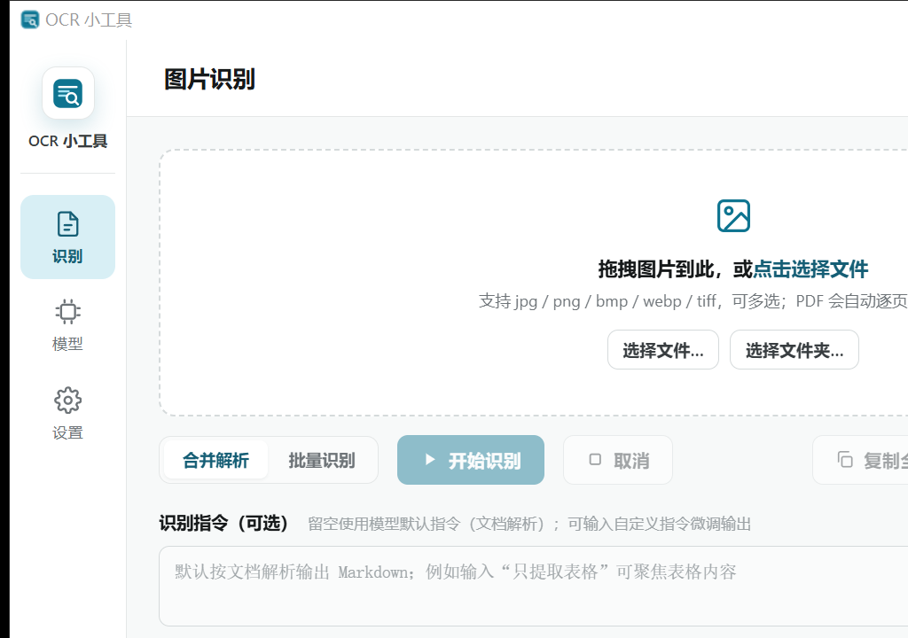
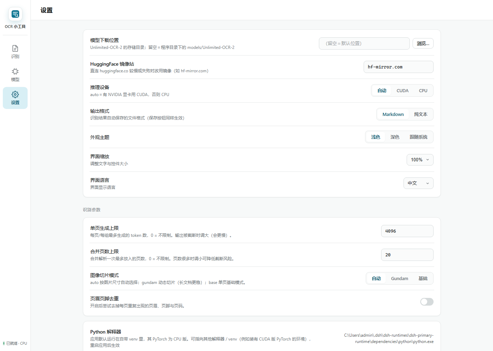
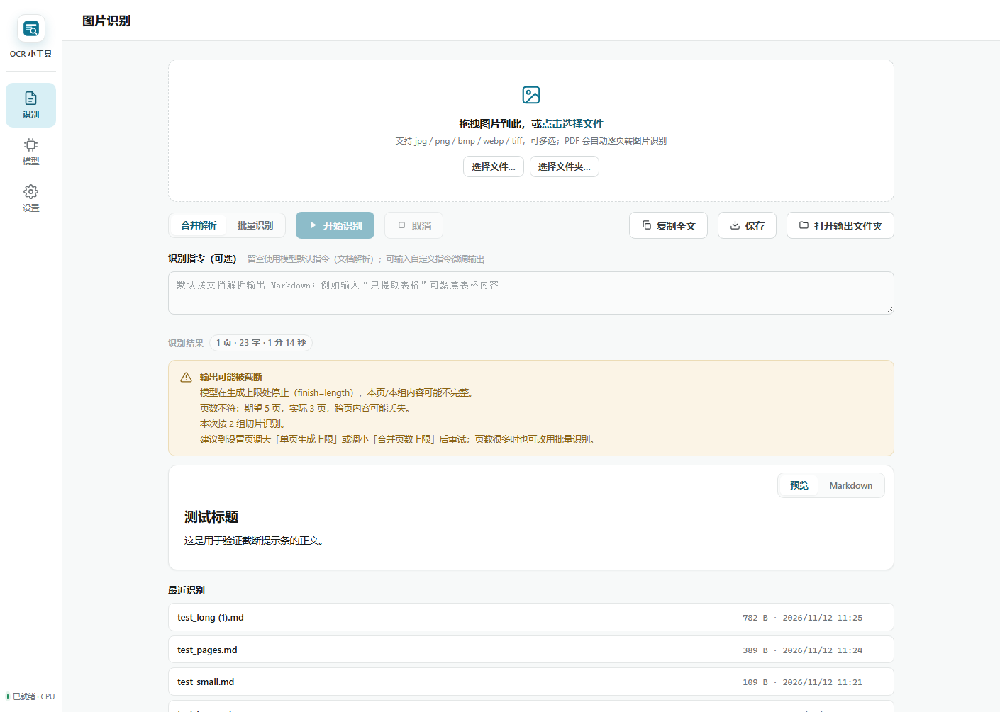
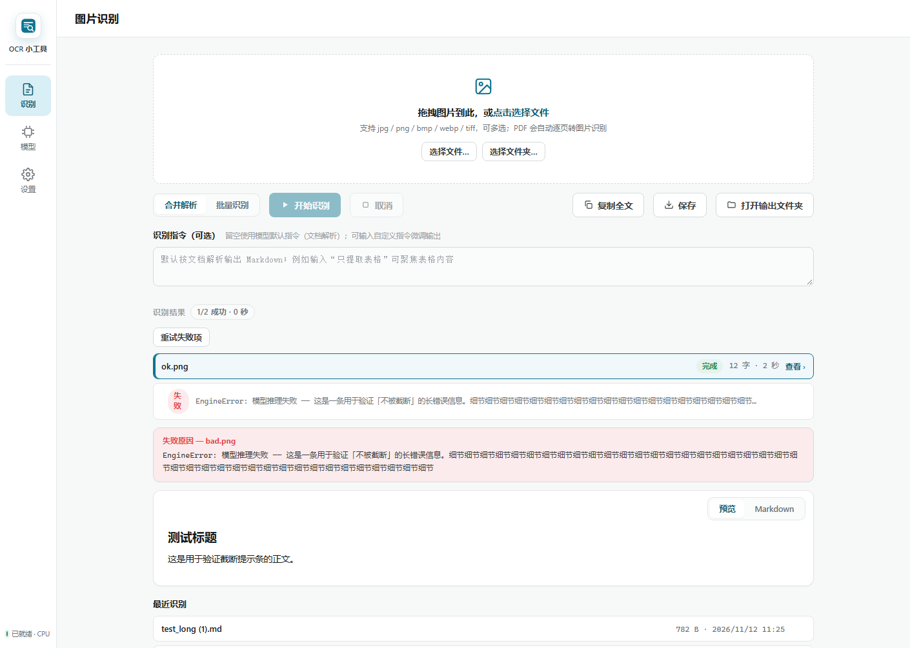
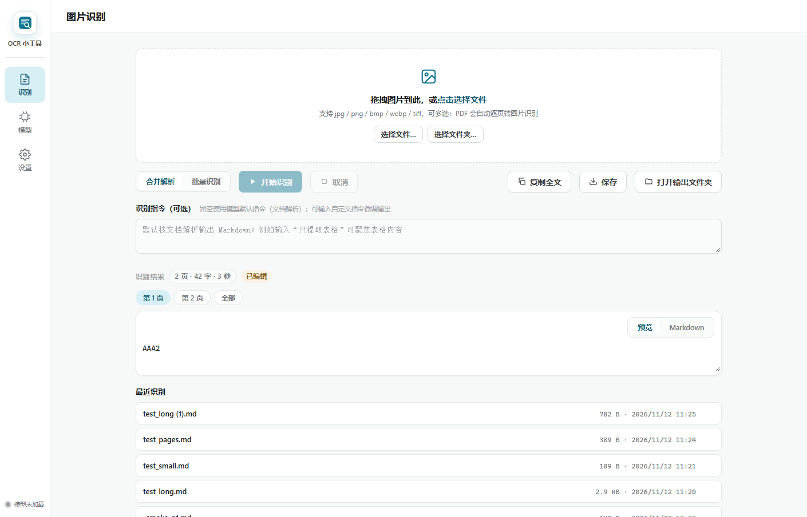
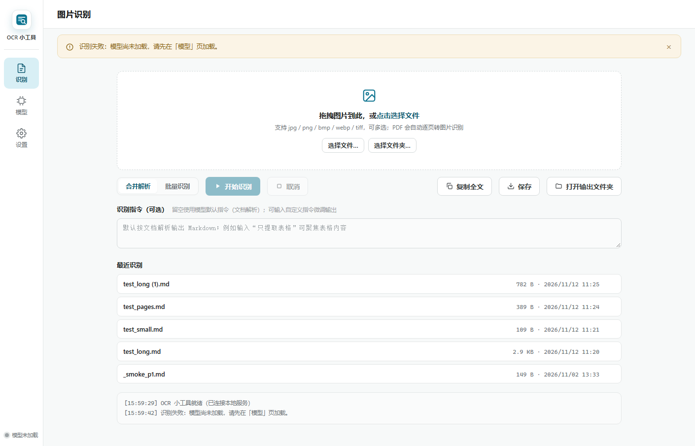
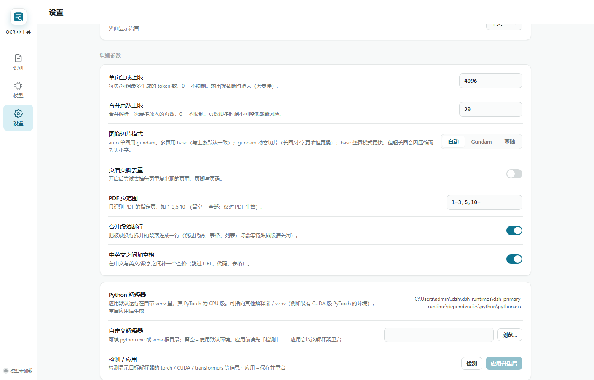
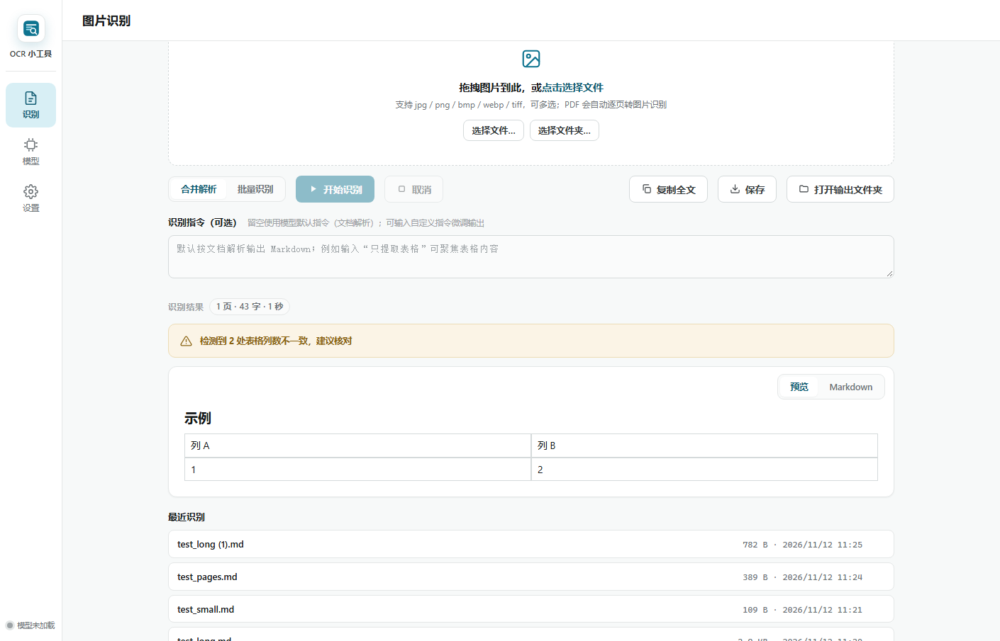

# OCRMiniTool v1.3.0 实机测试报告

| 项目 | 内容 |
|---|---|
| 测试日期 | 2026-11-12 |
| 被测版本 | v1.3.0（含本轮 P0/P1 全部落地） |
| 测试机 | Windows 10 教育版 1903 (10.0.18363)，GTX 1660 SUPER 6 GB（驱动 621.14），RAM 15.7 GB，WebView2 157.0.4341.46 |
| 运行时 | Python 3.12.14；torch **2.8.0+cpu**、transformers 4.52.1（复用了损坏 venv 的 site-packages，见 §4.4） |
| 结论 | 原生窗口、真实推理、截断标记、自动分组、切片降级、目录扫描、失败重试在真机均可用；**实测发现并修复 3 个缺陷**（其中 1 个会挡住源码用户加载模型） |

> 本次没有 GPU 版 torch（`torch.version.cuda is None`），因此**所有推理均为 CPU**。
> GPU 路径（cu128 组件）需要在装有 runtime 组件的机器上另行验证。

---

## 1. 原生窗口（产品真实形态）

启动 `python app_webview.py`：

| 观测 | 结果 |
|---|---|
| 本机服务 | `http://127.0.0.1:54790/`（port=0 随机端口） |
| 进程 / 窗口 | pid 12888，`MainWindowTitle=OCR 小工具`，`IsWindowVisible=True`，1024×720，`Responding=True` |
| WebView2 渲染 | 用 `PrintWindow(PW_RENDERFULLCONTENT)` 抓到**窗口内真实内容**（下方截图）——说明 pythonnet + WebView2 在本机可用，不是"只起了个空壳" |
| 模型状态 | 界面状态条「● 已就绪 · CPU」，加载约 27 s |
| 关闭行为 | `WM_CLOSE` 后 **3.5 s 内进程退出**，无残留 python 进程 |



---

## 2. 真实推理（CPU，真模型真权重）

| # | 场景 | 墙面耗时 | 引擎指标（新加的度量） | 结论 |
|---|---|---|---|---|
| 1 | 小图 520×160，gundam 切片 | 120.3 s | prefill **111.9 s** / decode 8.3 s / 75 tok / 9.0 tok/s / `finish=stop` / pages 1/1 | OCR 文本完全正确：`Invoice No. 2026-11-12`、`Total: RMB 1,234.56`、`金额：人民币一千二百三十四元` |
| 2 | 长截图 600×2400，`cropMode=auto` | 169.8 s | 计划日志 `crop=base`；prefill **46.2 s** / decode 123.6 s / 973 tok / 7.9 tok/s | **A6 生效**：auto 按 h/w=4 选中 base，prefill 46 s vs 同机 gundam 112 s（≈2.4×）；总耗时高是因为输出 973 字 |
| 3 | 3 页 PDF，`maxMergedPages=2` | 174.9 s | 计划日志 `pages=3 groups=2 max_new_tokens=8192`；分组日志「跨组不共享上下文」 | **A3 生效**：3 页自动切成 2 组，返回 `pages=3`、`groups=2`、页序正确 |
| 4 | 长截图，`maxPageTokens=256` | 74 s | `tokens=256`、**`truncated=true`**、`finish=length` | **E3 生效**：文本确实在 `Paragraph two: the quick` 处截断，且被如实标记（不是静默少内容） |
| 5 | 3 页 PDF 跑到 25 s 时点取消 | 141.2 s | `cancelled=true`、`pages=0`、无输出文件 | 如实反映**视觉/prefill 不可中断**：点了取消仍要等当前前向跑完（与修正后的 README/文案一致），但不会留下半截结果 |

### 2.1 这次实测推翻了什么、证实了什么

- **证实报告 01 的 S3**：单页时间几乎全在 prefill（视觉编码塔）——小图上 prefill:decode ≈ **13:1**。
  这也让 A12（视觉塔 fp32 A/B）成为下一步**性价比最高**的性能项：只要 prefill 快 1.5×，单页就快 1.4×。
- **证伪"CPU 慢是因为 decode 太慢"**：decode 实测 7.9–9.3 tok/s，与报告按内存带宽 8–12 GB/s 推算的
  ~10 tok/s 吻合；真正的瓶颈是视觉前向。
- **A2 的默认值需要真机校准**：长截图输出 973 token，说明 4096/页对普通页足够；
  但密集表格页可能顶到上限，建议用 2–3 份真实文档看 `finish=length` 出现频率再定 4096/6144/8192。

### 2.2 后续补做：A12 视觉塔 fp32 A/B（本轮已落地）

§2.1 指出瓶颈在视觉塔、并怀疑 bf16-on-CPU 是仿真路径。**后续已实测确认并落地**：

方法：同一进程内**交错** bf16 / fp32 各 3 轮（各 1 次 warmup 不计），固定
`crop_mode=base`、`max_page_tokens=256`，只切换视觉子模块的 dtype 桥
（`sam` 入参转 fp32 → `vision` 全 fp32 → `projector` 出口转回模型 bf16）。

| 图 | dtype | prefill 样本 (s) | 中位 | 端到端中位 |
|---|---|---|---|---|
| small 520×160 | bf16 | 46.3 / 47.3 / 48.8 | **47.3** | 55.8 s |
| small 520×160 | fp32 | 11.2 / 10.7 / 10.9 | **10.9** | 19.5 s |
| long 600×2400 | bf16 | 46.3 / 46.9 / 46.0 | **46.3** | 75.6 s |
| long 600×2400 | fp32 | 11.2 / 10.4 / 10.9 | **10.9** | 40.1 s |

- **prefill 加速 4.35× / 4.26×**；decode 两个 dtype 完全一致（8.3 s），证明只动了视觉塔
- **输出逐字节相同**（similarity 1.0，diff 为空）——桥接没有静默降精度
- 默认策略已改为 `auto → CPU: fp32 / CUDA: bf16`，日志会打一行
  「视觉塔 dtype 策略：mode=auto → fp32（device=cpu）」；
  带 AVX512-BF16 的新 CPU 可用 `OCRMIT_VISION_DTYPE=bf16` 回退
- 代价：常驻内存 +0.78 GB、加载多 1–2 s

**端到端复验**（同一张图、同一参数，只改默认）：`120.3 s → 18.8 s`（prefill 111.9 → 10.6 s）。
副作用是**瓶颈转移**：现在 decode（约 9 token/s）占了普通页的大头，下一步优化重心应从
视觉塔转到「解码时的 KV 上采样」（报告 01 的 S2：每 token 把整份 KV `.float()` 两遍）。
---

## 3. 界面（真实 Chromium 内核，CDP 驱动）

用 headless Edge（与 WebView2 同内核）通过 DevTools 协议**真正点击与读 DOM**：

| 验证点 | 结果 |
|---|---|
| 语言 | `document.documentElement.lang = zh-Hans`，标题「图片识别」 |
| S1 设置四控件读后端值 | `#set-max-tokens=4096`、`#set-max-merged-pages=20`、`#set-crop-mode .on=auto`、`#set-drop-headers=false` |
| S1 改值真的写回 | 控件改成 7 → `GET /api/settings` 立即返回 `maxMergedPages=7` |
| S3 目录入口 | 「选择文件夹…」按钮存在 |
| S2 截断提示条 | 渲染出完整四行（见下文） |
| S4 批量失败面板 | 显示完整错误 139 字符（不再截到 80/300 字） |
| 最近识别 | 列出真机跑出来的 `test_long (1).md / test_pages.md / test_small.md` |



截断提示条的真实文案（DOM 取出）：

> 输出可能被截断
> 模型在生成上限处停止（finish=length），本页/本组内容可能不完整。
> 页数不符：期望 5 页，实际 3 页，跨页内容可能丢失。
> 本次按 2 组切片识别。
> 建议到设置页调大「单页生成上限」或调小「合并页数上限」后重试；页数很多时也可改用批量识别。





---

## 3.5 后续补做：A6「长截图自动降 base」被真机证伪（已回退）

`maxPageTokens` 校准用的 D6（600×3600 超长截图）暴露出一个**我们自己引入的质量回归**：

同一张图、同一参数，只换切片模式：

| 切片 | 输出 | 结果 |
|---|---|---|
| `base`（旧 auto 会选它） | 「不要将指导书用绳子或金属棒串，但切勿将过程中尺寸计算截了套节或套了绳一捆一捆地捆扎，以免对电路板的使用导致电费」 | **语义崩坏**，与源文重合 0/74 句；第 2238 字起单短语重复 197 次，8192 上限内跑了 36 分钟仍未停（人工终止） |
| `gundam`（新 auto 选它） | 「# 产品使用手册（节选）… 页眉页脚与页码属于版面噪声，但在部分版式中它们承载了章节信息，不能一概丢弃」 | 连贯正文，`finish=stop`，2713 token，594.9 s |

根因：`base` 把 600×3600 压成极窄分辨率 → 正文不可读 → 模型开始编造甚至退化重复；
省下的 prefill（12.8 s vs 32.8 s）是用正确性换的。

处理：`_auto_crop_mode` 回退为上游语义（**单图 gundam、多页 base**），`base` 保留为用户显式选项；
README 与界面文案都写明「base 会压缩超长图并可能丢小字」。顺带删掉了为判定长宽比而做的
「每次识别打开图片读尺寸」。

> 这条结论同时说明：**token 上限是安全阀，不是"越大越好"**——真正让长图跑飞的是切片模式。
> 校准结论因此是「保持 4096、不做分档」（见 [token-budget.md](token-budget.md)）。


---

## 3.6 后续补做：打包版 EXE 与 GPU 路径（真机）

### 3.6.1 打包版（PyInstaller onedir，HEAD 构建 100 s）

| 项目 | 结果 |
|---|---|
| 产物 | `dist/OCRMiniTool/` 294.2 MiB / 3389 文件；`OCRMiniTool.exe` 29.7 MiB；发行 zip 144.1 MiB |
| 启动（无组件） | 窗口 2.67 s，标题「OCR 小工具」，WebView2 子进程 + `RenderWidgetHost` 在位；`/api/status` version=1.3.1；未装组件时 `/api/load` 返回**可读错误**且进程存活 |
| CPU 组件安装 | 62.4 s（260.3 MB）：`.part` → 改名 → 装完自动删 zip；marker/11 个 DLL/无 `torch_cuda.dll` 全对 |
| 真机 OCR（打包版，fp32） | `test_small.png` **29.7 s**（prefill 21.3 / decode 8.3 / 75 tok / 9.1 tok/s），输出正确——**A12 在打包版同样成立**（旧逻辑约 120 s） |
| PDF | `test_pages.pdf` 74.7 s / 3 页，输出含分页标记 ⇒ **`fitz`（pymupdf）打包可用**，原疑点解除 |
| 退出 | 关窗 exit code 0，无残留进程 |

### 3.6.2 CUDA（cu128 组件 + GTX 1660 SUPER 6 GB）

先验了分卷续传修复（D6）的**真实链路**：干净 `runtime/` + 完整 part02 + 截尾 100 MiB 的
`part01-of-2.part` → 应用日志 `part01-of-2.part: download OK (1900.0 MB)`（Range 只补 100 MiB）
→ 拼接 3,499,385,137 B → 解压 → marker `cu128`，全程 66.3 s。
「暂存名 → HEAD 大小 → 续传 → 核对 → 改名 → 拼接 → 解压 → 标记」实测通过。

| 项目 | 结果 |
|---|---|
| CUDA 检测 | ✅ torch 2.8.0+cu128 / cudaBuild 12.8 / GTX 1660 SUPER / 6.4 GB |
| 模型加载 | 冷启动 67.9 s，VRAM 峰值 **5875 / 6144 MiB**，**无 OOM** |
| 视觉塔 dtype | `auto → bf16（device=cuda）`——A12 的策略在 CUDA 上正确选 bf16 |
| 单页（小图 gundam） | 32 s（prefill 21.7 / decode 10.1 / 7.4 tok/s）——**与 CPU 30 s 基本持平，GPU 无收益** |
| 长图（600×2400，gundam） | **1017 s**（prefill 45.4 / decode **971.7** / 1521 tok / **1.6 tok/s**） |

结论与修正：
- **「6 GB 放不下 6.3 GB 权重」不成立**——WDDM 允许超卖到共享内存，能加载能跑；
- 但 6 GB 是**「能跑但性能悬崖」**：余量不足 300 MiB，长图 decode 掉到 1.6 tok/s，
  比 CPU fp32 还慢。据此加了**显存护栏**（见 §4.7）：`auto` 在显存 < 7.5 GB 时直接用 CPU；
  用户显式选 CUDA 则尊重选择但记录日志。
- 本次**未触发 OOM**，所以「OOM 错误是否可读 / 是否自动回退 CPU」仍无实测数据
  （按代码推断：CUDA OOM 会走加载失败错误路径，不会自动回退）。


---

## 3.7 后续补做：第一批（B9/B11/F7/F15）真机行为验证（headless Edge/CDP）

这一批是纯前端交互，静态用例只能证明「代码写了什么」；因此另写 `_work/cdp_batch1_test.py`，
在 headless Edge（与 WebView2 同内核）里用 CDP 真实输入/点击：注入两页假结果后
逐项断言，**31/31 通过**（版本 v1.3.3，HEAD 含 B9/B11/C11/A9/F7/F15）。

| 组 | 真实验证点 |
|---|---|
| **B9** | 逐页视图可编辑；改第 1 页 → `pages[0]` 更新且 `text` 按 `<!-- page N -->` 重拼；切第 2 页改 → 两处编辑都在；切回第 1 页仍是改后内容；「全部」页签只读且有 hover 提示；「已编辑」chip 出现；批量条目同步 `text/chars` |
| **B11** | `flashError` 后顶部横幅可见、文案正确、**不在 `.view-host` 滚动容器内**、可点 × 关闭；同一条错误仍在底部 `#ocr-log` 留档 |
| **F7** | 同文件连续两次 → 只入列 1 个；同名但 mtime 不同 → 2 个 |
| **F15** | 运行中 `#prompt-box` / 选文件 / 选目录 / 清空均 `disabled`、`addFiles` 被拒；结束后全部恢复 |



*原文视图直接改字：改的是「第 1 页」，结果区显示「已编辑」，保存/复制取改后内容。*



*识别失败时顶部横幅（可关闭），底部日志区仍有同一行；错误不会再「藏在页面最下面」。*

> 局限：这仍是 headless 内核的自动化验证，不等于人工肉眼验收；缩放/主题观感、
> 原生窗口里的输入法候选框行为，仍建议在本地终端再点一遍（README 的界面截图已同步）。
> 脚本位于工作区外 `_work/cdp_batch1_test.py`，未入库（依赖本机 Edge 与随机端口）。

---

## 3.8 后续补做：第二批（B13/E6/E7/C2/E12–E14）真机行为验证（headless Edge/CDP）

第二批的界面与语义改动同样用 `_work/cdp_batch2_test.py` 在 headless Edge 里做真按键/
真事件验证：**35/35 通过**（v1.4.0）。

| 组 | 真实验证点 |
|---|---|
| **B13 键盘** | Ctrl+Enter 与 Cmd+Enter 都触发开始；运行中再按被忽略；Esc 只在运行中取消（空闲不吞键）；`#drop` 的 Enter/Space 打开选择框；`#btn-pick-dir` 等子按钮键盘激活不被父容器抢；`#model-status` Enter 切模型页；历史 `.hx` Enter 删除且不会误打开文件 |
| **F12 aria** | 三个进度容器 `aria-valuenow` 随 `setProgress`/模型/组件进度更新；`#ocr-log`、`#result-meta` 有 `aria-live` |
| **E6 粘贴** | 合成 paste 事件入列 `pasted-1.png` 并提示；输入框内粘贴不拦截；纯文本粘贴不误报 |
| **E7/E12 设置** | 三个新控件回填后端值；输入后 debounce 提交、失焦立即提交；结尾逗号的半截输入不提交；非法页范围被后端拒绝且 banner 可见、不落盘 |
| **E14 表格告警** | 单条 / 批量聚合 / 「截断+表格」三种组合的提示行正确；纯表格告警不附「调大单页上限」的误导提示 |
| **C2 409** | 忙时桥接抛 Error → 顶部横幅可见、文案含「409」且可读 |





> 局限同 §3.7：headless 内核的自动化行为验证，不等于人工肉眼验收；脚本在工作区外
> `_work/cdp_batch2_test.py`，未入库。

补充：页范围与 busy 语义另用 `_work/verify_batch2.py` 在**真后端**上验证 14/14——
真实 5 页 PDF 的 `pdf_to_images(page_range=)` 只导出选中页且文件名保留原页号、
开区间/越界夹取、非法 spec 报 `err.badPageRange`、A9 护栏按选中页数放行、
settings 三键默认/非法不落盘/合法写回、忙时 `POST /api/recognize` 返回 **HTTP 409**。

---

## 4. 实机发现的问题（7 个已修，1 个记录在案）

### 4.1 【严重·已修】源码运行时无法加载模型

**现象**：venv 里明明装着 torch 2.8.0，模型文件也齐，点「加载模型」却返回
「尚未安装推理引擎组件——请在上方按显卡下载（CPU / CUDA 二选一）」。

**根因**：`start_load()` / `env_ready()` 只认 `runtime/torch_build.json`（冻结版组件标记），
不认源码运行 venv 里的 torch。这是 v1.2.0「推理引擎组件化」留下的断点：
`README` 教用户 `pip install -r requirements.txt` 后再 `python app_webview.py`，
但那条路径会被组件守卫挡住。CLI 走的是 `engine.load()`、不经过这个守卫，所以
命令行测试全绿也没暴露；单测里又都 mock 掉了 `quick_check_torch`。

**修复**：新增 `_torch_from_source_env()`——非冻结环境且 `find_spec('torch')` 有真实 origin
即视为就绪；**冻结版仍只认组件**（安装包里没有 torch，不能让 venv 蒙混）。
补 `tests/test_backend_env.py` 6 条用例（含"命名空间包不算就绪""冻结版必须组件"两个反例）。

### 4.2 【中·已修】关窗/刷新就刷一整段 traceback

**现象**：关闭窗口或刷新页面后，控制台/日志出现
`ConnectionAbortedError: [WinError 10053]` 整段栈。

**根因**：keep-alive 连接上客户端先关闭，handler 线程在 `readline` 撞到连接中止，
`socketserver` 把它当"处理请求异常"打印。连接已死，这不是错误。

**修复**：`_QuietServer.handle_error` 静默 `ConnectionError/TimeoutError`，**其余异常照常上报**
（避免把补丁写成"关闭日志"）；补 3 条用例，其中一条专门断言真异常必须仍然可见。

### 4.3 【低·已修】settings.json 被写成 CRLF

**现象**：真机跑一次后 `settings.json` 变成 CRLF，`tools/check.py` 报警。

**根因**：`SettingsStore._write` 用 `Path.write_text`，Windows 上默认把 `\n` 翻译成 `\r\n`。

**修复**：显式 `newline="\n"`；同时让 `check.py` 跳过运行时用户数据 `settings.json`
（它是被程序改写的运行产物，不该参与仓库行尾体检）。

### 4.4 【低·未修，记录】首屏有一次英文闪现

`webview/locales` 与设置里的语言是中文，但 `index.html` 的静态文案是英文，
在 `/api/settings` 返回并 `setLang('zh')` 之前会闪现约 200 ms 英文。
影响很小（本机 headless 首次截图正好抓到），修法有两条：① 静态骨架文案留空、
由 i18n 首帧填充；② 把当前语言随首页一起注入（服务端模板化 index.html）。留作待办。

### 4.5 【严重·已修】运行中切换推理引擎组件必然失败

**现象**（打包版真机）：已装 CPU 组件、运行中再装 cu128 → 覆盖
`runtime\PIL\_imaging.cp312-win_amd64.pyd` 报 `PermissionError`；marker 仍是 cpu、
**白留 3.5 GB 安装包**、无回滚。换干净 `runtime/` 才成功。

**根因**：进程已经把旧组件的 `.pyd` 当 DLL 载入，Windows 不允许覆盖正在映射的文件。

**修复**（两层）：
1. `start_env_download` 提前拒绝：目标 flavor ≠ 已装 flavor 且本进程已 `import torch`
   → 返回「切换组件需要重启应用」的**可操作提示**（新增 `err.envSwitchNeedsRestart`），
   不让用户等 3.5 GB 下完才失败；
2. `download_torch` 解压/安装失败时**删除安装包**，不再留 3.5 GB 垃圾。

### 4.6 【中·已修】自动加载抢在建窗之前（窗口 20.1 s → 3.4 s）

**现象**：模型与组件都就绪时，双击后 **20.1 s 才出现窗口**（无模型时 2.67 s）——
用户感知是「点了没反应」。

**根因**：`start_load()` 在 `run_native_window()` 之前同步执行，模型加载抢占了建窗时间。

**修复**：把自动加载改成建窗回调（`webview.start(on_start)`）+ Edge 回退路径延迟 2 s。
真机复测：**窗口 3.4 s 出现**（模型在后台继续加载，状态条会显示进度）。

### 4.7 【中·已修】6 GB 显卡「能跑但更慢」→ 加显存护栏

§3.6.2 显示 6 GB 卡上 CUDA 能加载，但长图 1.6 tok/s、比 CPU 还慢。
`auto` 现在按显存选设备（`_MIN_CUDA_VRAM_GB = 7.5`）：不足则用 CPU（fp32 视觉塔），
并在日志里说明原因；用户**显式**选 CUDA 时仍尊重选择，只记录「此档位可能更慢」。
`_pick_device` / `_cuda_vram_gb` 为纯函数，配 12 条单测。


---

## 5. 复现方式

```bash
cd OCRMiniTool
# 本机 .venv 的解释器已损坏（uv trampoline 指向 C:\Users\X1C\...），但 site-packages 完好，
# 因此用任意 Python 3.12 + PYTHONPATH 复用依赖即可（裸机请按 README 正常 pip install）：
PY="C:/Users/admin/.dsh/dsh-runtimes/dsh-primary-runtime/dependencies/python/python.exe"
export PYTHONPATH="D:/Project/OCRMiniTool/.venv/Lib/site-packages"

# 1) 命令行真实识别（含度量日志）
"$PY" cli.py --input <图片或PDF> --out out --max-page-tokens 512 --verbose

# 2) 起真实后端（不打窗口），打 API
"$PY" webview_server.py            # http://127.0.0.1:8770/

# 3) 原生窗口
"$PY" app_webview.py
```

模型与推理日志会写进 `logs/app-YYYYMM.log`，其中 `识别计划` / `引擎指标` 两行就是本次
新增的度量（prefill/decode/tokens/tok-s/finish/pages/分组）。

---

## 6. 未覆盖 / 下次要测

1. **GPU 路径**：本机 torch 是 +cpu，GTX 1660S 未参与运算；装有 cu128 组件的机器需补测
   （预期 prefill 从 ~110 s 降到数秒级）。
2. **打包版 EXE**：需 PyInstaller 构建机；`console=False` 下 CLI 不可用这一点已在
   `docs/cli.md` 写明。
3. **视觉细节**：RDP 会话的 `CopyFromScreen` 受限，界面截图取自 `PrintWindow` 与 headless
   Chromium；缩放档位、深浅色主题的观感建议在本地终端肉眼过一遍。
4. **默认值校准**：`maxPageTokens=4096` 是否合身，需用真实文档看 `finish=length` 频率。
